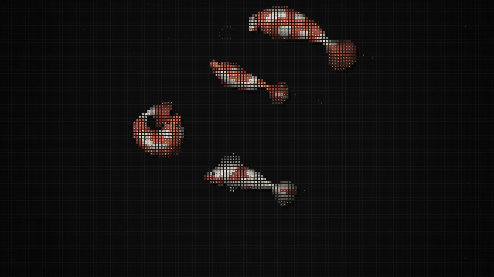
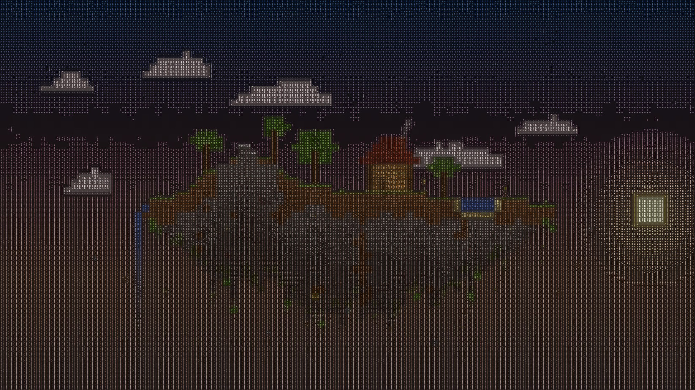
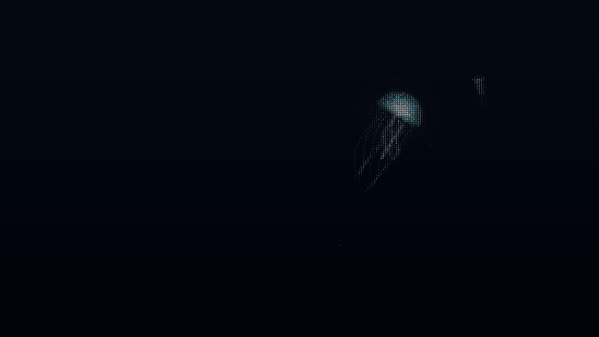
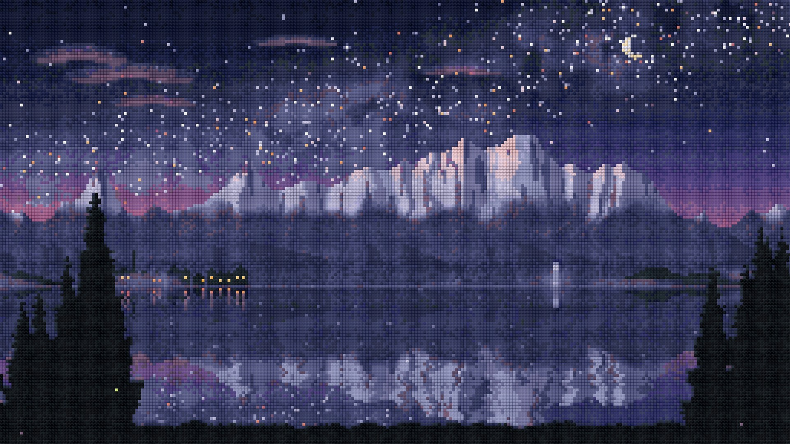
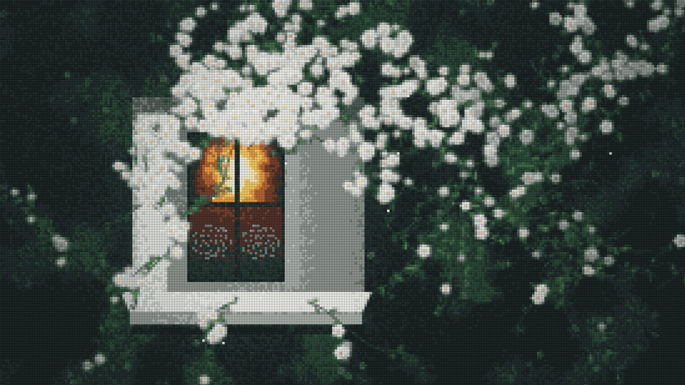

# wallpaper

Generated wallpapers: **live wallpapers** (ASCII art and cross-stitch, as web pages and videos) and a **static 4K** set.

Open `index.html` in the repository root for a gallery of everything.

## Live wallpapers `live/`

### ASCII

| Wallpaper | What it is | Options |
| --- | --- | --- |
| **Shoal** `live/shoal.html` | Koi built from glyph tiles swimming over a grid: scales, dorsal line, gills, finned tail and pectoral fins, side lighting and shadows, barbels, ripples. Fish flee from the pointer. | `?theme=light` grey on paper · `?fish=8` number of fish |
| **Isle** `live/isle.html` | A floating block island: a cabin with a smoking chimney, falling leaves, a pond, a waterfall, clouds, sun and moon. Runs a full day/night cycle; at night lanterns, the window and glowstone light up the blocks around them, and fireflies come out. The terrain is different on every load. | `?time=day/sunset/night` fixed time · `?day=60` seconds per day · `?seed=7` fixed terrain · `?res=200` finer glyphs · `?ascii=0` plain block version |
| **Abyss** `live/abyss.html` | The deep sea, beyond the reach of sunlight. A single glowing jellyfish drifts through the dark, its tentacles trailing the path it swam. Marine snow shows only where its light falls, and now and then something flickers far away. Moving the pointer stirs faint bioluminescence. | `?res=200` finer glyphs · `?ascii=0` plain version |





### Cross-stitch

| Wallpaper | What it is | Options |
| --- | --- | --- |
| **Vista** `live/vista.html` | A mountain valley at blue hour: the Milky Way, peaks holding the last pink light, a mirror lake, a lakeside village with lit windows, a waterfall, mist along the mountains, shooting stars, birds, and a lantern boat crossing the water. | `?res=200` finer stitches |
| **Bloom** `live/bloom.html` | A lit window at night, wrapped in white blossoms. The vines sway, petals fall, the lamp flickers and a moth circles the light. Moving the pointer is like a gust of wind. The vines grow differently on every load. | `?res=200` finer stitches |




### How it works

- `live/runtime.js`: a full-screen canvas runtime (high-DPI, fixed time step, pointer input, frame-exact recording) with two shared post-processing layers:
  - `makeAscii` samples the scene per cell, picks a glyph from a 70-step ramp by brightness and strokes edges with `/ \ | -`. Translucent layers (sky, glows) become sparse coloured glyphs. Add `?ascii=1` to any live wallpaper to turn it into ASCII.
  - `makeStitch` draws the scene at one pixel per stitch, snaps every stitch to a fixed set of thread colours, then scales it up under an aida-cloth texture.
- `live/blocks.js`: procedural block textures (grass, dirt, stone, ores, mossy cobble, logs, leaves, planks, brick, roof tiles, door, window, lantern, glowstone, water, waterfall, snow, sand, wool, flowers, tall grass, hanging roots).

Recorded videos are in `output/live/*.mp4` (desktop 1920×1080, phone 1080×2340).

## Mac app: Wallpaper (recommended)

A menu bar app that puts the live wallpapers behind your desktop icons. It starts at login and updates itself.

**One-line install**: open Terminal, paste this and press Return:

```bash
curl -fsSL https://raw.githubusercontent.com/t1anhe/wallpaper/claude/affectionate-hamilton-in1kmo/mac/install.sh | bash
```

The script downloads the latest build, puts it in Applications and opens it. If the older LiveWall app is installed it is replaced, and anything in `~/LiveWall` moves to `~/Wallpaper`. Installed this way, macOS does not show the "unidentified developer" warning.

To install by hand instead, download `Wallpaper.zip` from [Releases](https://github.com/t1anhe/wallpaper/releases/tag/mac-latest), unzip it and drag the app into Applications. The first time you open it, go to **System Settings → Privacy & Security** and click **Open Anyway**.

Once installed, a ✦ icon appears in the menu bar. Click it to pick a wallpaper.

**Menu**: wallpapers · Shuffle · Pause/Resume · Open Wallpaper Folder · Reload · Check for Updates · Automatic Updates (on by default) · Launch at Login (on by default) · Quit

**Updates**: the app checks when it starts and then every 6 hours. When a new build is out it downloads it in the background, swaps itself in place and relaunches. New wallpapers arrive with app updates.

**Adding wallpapers**: everything lives in `~/Wallpaper` (menu → Open Wallpaper Folder). Drop files in and they show up the next time you open the menu:

- web wallpapers: `.html` (may load scripts and images next to them)
- videos: `.mp4` `.mov` `.m4v` (muted, looping)
- images: `.jpg` `.png` `.heic` `.gif` `.webp`

Notes:

- Every display shows the wallpaper. Pointer movement is forwarded to web wallpapers, so the koi still flee from the mouse.
- Playback pauses while the screens sleep or the session is locked.
- The bundled wallpapers are copied into `~/Wallpaper` on first launch and refreshed on every update. Files you add yourself are never touched.
- Requires macOS 12 or later, on Intel or Apple silicon.
- The source is in `mac/`. Pushing changes to `mac/`, `live/` or `lib/` makes GitHub Actions rebuild the app on a macOS runner and refresh the `mac-latest` release, and installed copies update to it.

## Other ways to use them

**1. Get the files**

- Easiest: on GitHub, switch to the `claude/affectionate-hamilton-in1kmo` branch → `Code` → `Download ZIP`, and unzip it.
- Or with git:
  ```bash
  git clone -b claude/affectionate-hamilton-in1kmo https://github.com/t1anhe/wallpaper.git
  ```
  Run `git pull` inside the folder to get updates.

**2. Set a live wallpaper**

- **Windows**:
  - [Lively Wallpaper](https://www.rocksdanister.com/lively/) (free, on the Microsoft Store): drag in an `.html` file from `live/` (interactive), or an `.mp4` from `output/live/`.
  - Wallpaper Engine (paid, on Steam): Editor → Create Wallpaper → choose the web type and point it at `live/<name>.html`, or import an mp4.
- **macOS**: use the Wallpaper app above, or [Plash](https://sindresorhus.com/plash) (free, App Store) with `file:///path/to/wallpaper/live/vista.html`.
- **Phone**: copy `output/live/*-phone.mp4` to your phone. On iPhone, convert the video to a Live Photo with a converter app and set that as the wallpaper. Most Android launchers, or a video wallpaper app, take the video directly.

## Static wallpapers `static/`

Dunes, Bauhaus, Silk, Topography and Aurora: `output/static/*-desktop.jpg` (3840×2160) and `*-phone.jpg` (1290×2796).

## Regenerating

Needs Node.js, Playwright (Chromium) and ffmpeg.

```bash
node render-static.js                        # re-render all static wallpapers
node record.js vista --secs 20               # record a Vista video
node record.js isle --secs 40 --query day=40 # record one full Isle day
node record.js shoal --size 1080x2340        # phone size
node record.js vista --stills 3,10           # just a few PNG frames
```
